## 6. Dokumentasi Praktikum Modul 11 — Optimasi Daftar Tugas

## Identitas Mahasiswa

> [!IMPORTANT]
> **Wajib Mengganti Data di Bawah Ini!**  
> Autograding CI/CD akan memeriksa apakah nilai *placeholder* di bawah ini telah diganti dengan Nama dan NIM Anda yang sebenarnya. Jika belum diganti, pengujian `verify_documentation_test.dart` akan gagal.

| Informasi | Data Mahasiswa                                         |
|---|--------------------------------------------------------|
| **Nama Lengkap** | Antoni Silha Indriyan Priyadi |
| **NIM** | 362558302006                                           |
| **Kelas / Angkatan** | TRPL 2E / 2025                                         |
| **Dosen Pengampu** | Sepyan Purnama Kristanto, M.Kom.                       |

---

### A. Tujuan Praktikum

Praktikum ini bertujuan untuk memahami penerapan optimasi tampilan daftar pada Flutter menggunakan `ListView.builder`. Selain itu, praktikum dilakukan untuk memahami pengelolaan data dan proses penyaringan, menguji perilaku aplikasi berdasarkan skenario pengguna, serta mengamati performa aplikasi menggunakan Profile Mode dan Flutter DevTools.

### B. Lingkungan Pengujian

| Komponen | Keterangan |
|---|---|
| Framework | Flutter |
| Bahasa Pemrograman | Dart |
| IDE | Visual Studio Code |
| Modul | Modul 11 — Optimasi Daftar Tugas |
| Perangkat Pengujian | [Nama perangkat / emulator] |
| Sistem Operasi | [Versi Android / Windows] |
| Mode Pengujian Performa | Profile Mode |
| Jumlah Data | 1.000 data tugas |

### C. Langkah Kerja dan Hasil Pengamatan

#### 1. Menjalankan Starter dan Mengamati Baseline

**Perintah yang digunakan:**

```bash
flutter pub get
flutter run
```

Pada tahap ini dilakukan persiapan project dengan mengunduh seluruh dependensi yang diperlukan, kemudian menjalankan aplikasi menggunakan Flutter. Setelah aplikasi berhasil dijalankan, Modul 11 dibuka melalui peluncur aplikasi untuk mengamati kondisi awal sebelum dilakukan perubahan kode.

**Hasil pengamatan:**

Pada saat awal running tertampil sebuah halaman pengelolaan daftar tugas beserta mata kuliahnya, disana juga adanya fitur searching dan sorting.

**Dokumentasi:**

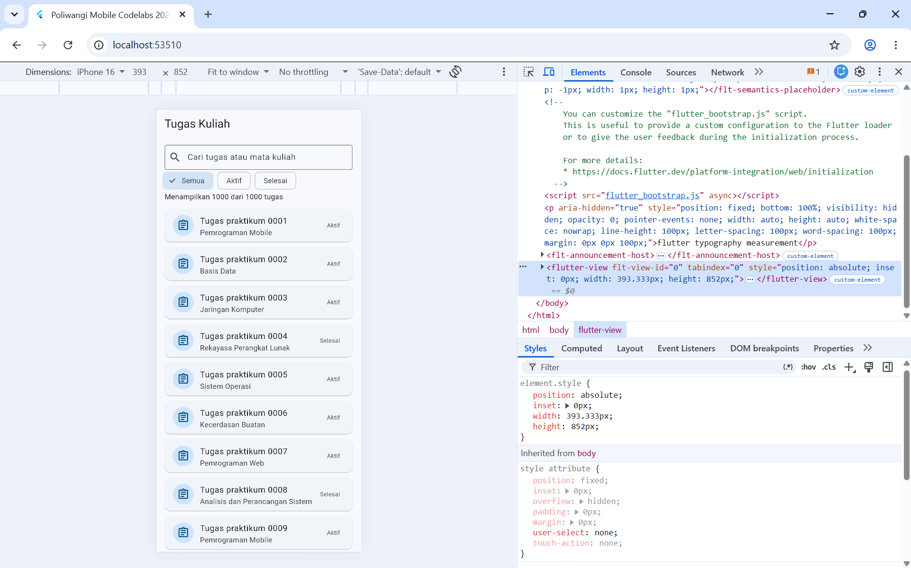

#### 2. Mengenali Data dan Filter

Pada tahap ini dilakukan pengamatan terhadap struktur pengelolaan data dan mekanisme penyaringan pada file `lib/modul_11/modul_11_app.dart`.

Beberapa komponen yang diamati meliputi:

| Komponen | Fungsi |
|---|---|
| `List.generate(1000, ...)` | Membuat 1.000 data tugas sebagai data sumber. |
| `StatusTugas` | Enum yang mendefinisikan status tugas aktif dan selesai. |
| `_semuaTugas` | Menyimpan seluruh data tugas yang tersedia. |
| `_kueri` | Menyimpan kata kunci yang dimasukkan pengguna. |
| `_filter` | Menyimpan status yang dipilih sebagai filter. |
| `_hasil` | Menghasilkan daftar tugas berdasarkan proses pencarian dan penyaringan. |

**Hasil pengamatan:**

Data sumber merupakan keseluruhan data tugas yang dibuat menggunakan `List.generate` sebanyak 1.000 data. Data tersebut kemudian diproses berdasarkan kata kunci pencarian yang disimpan dalam variabel `_kueri` dan status yang dipilih melalui `_filter`.

Hasil dari proses tersebut ditampilkan melalui getter `_hasil`, sehingga data yang ditampilkan dapat berubah sesuai dengan kriteria pencarian dan filter yang digunakan.

**Dokumentasi:**

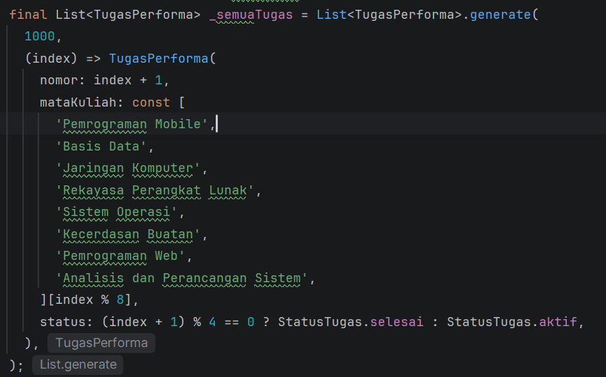

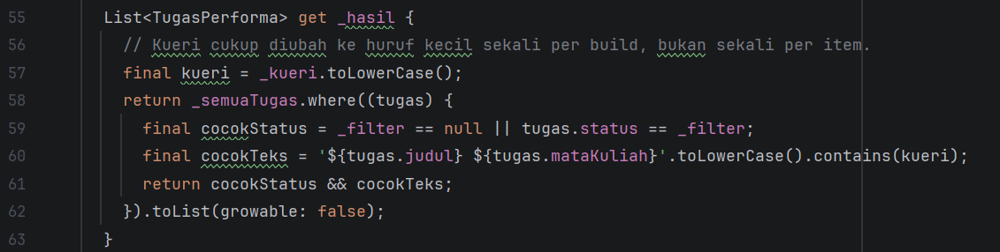
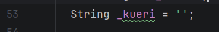

#### 3. Menelusuri ListView.builder

`ListView.builder` digunakan untuk membangun item daftar secara bertahap sesuai dengan kebutuhan tampilan. Properti `itemCount` menentukan jumlah data yang tersedia untuk ditampilkan, sedangkan `itemBuilder` bertugas membangun widget setiap item berdasarkan indeks data. Widget `_KartuTugas` digunakan untuk membentuk tampilan masing-masing tugas.

**Perintah pengujian:**

```bash
flutter test test/modul_11_test.dart
```

**Hasil pengujian:**

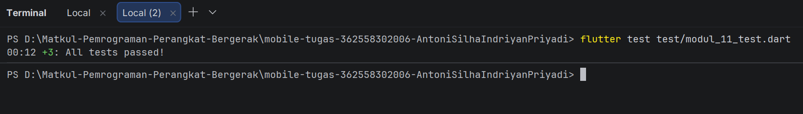

**Dokumentasi:**

Tercantum di layar "Menampilkan 1000 dari 1000 tugas"
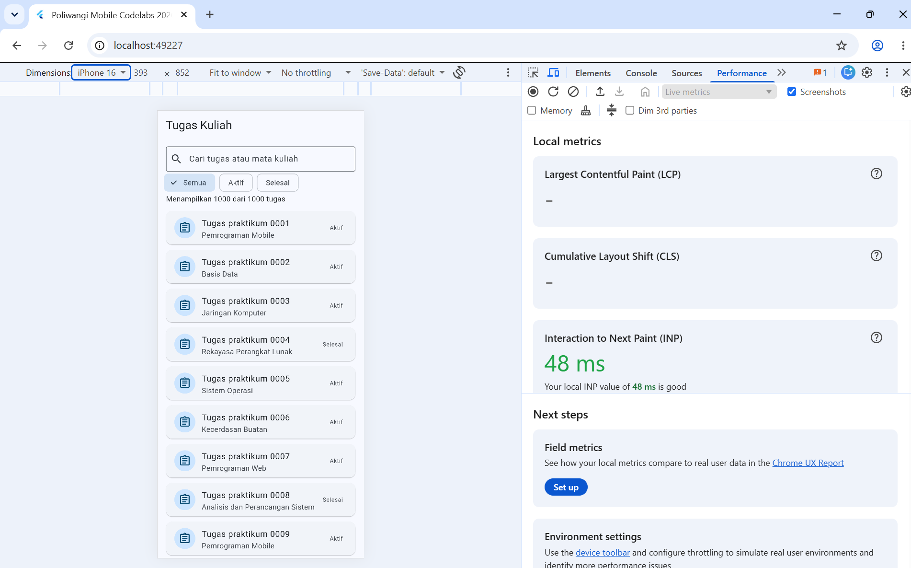

#### 4. Menguji Skenario Pengguna

**a. Pengujian pencarian tugas**

Kata kunci yang digunakan:

```text
tugas praktikum 0002
```

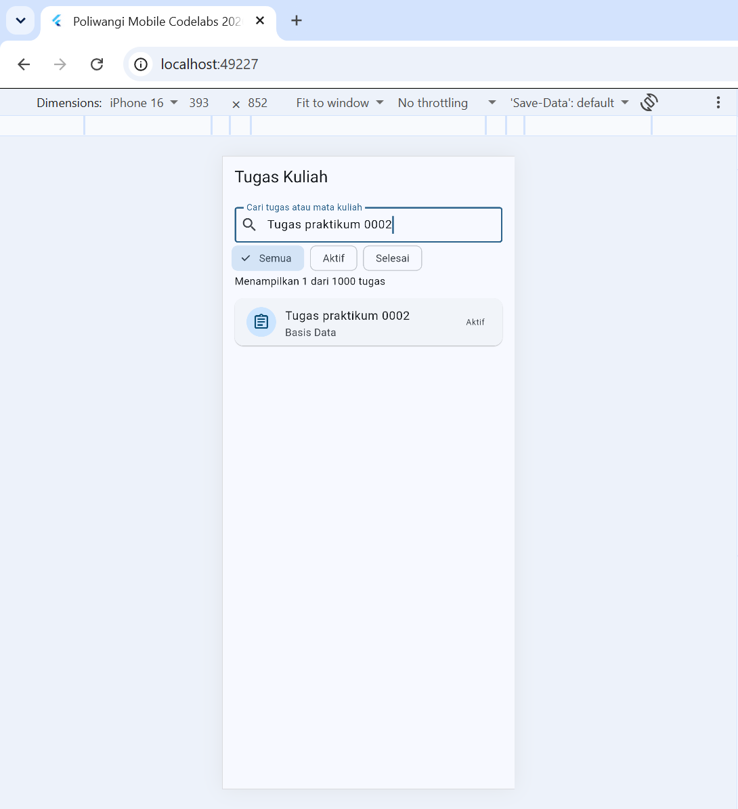

**b. Pengujian filter Selesai**

Setelah pencarian dibersihkan, filter Selesai dipilih untuk menampilkan seluruh tugas dengan status selesai.

Hasil yang diharapkan adalah 250 tugas dari total 1.000 data. Hal tersebut dikarenakan setiap tugas keempat pada data sumber diberikan status selesai.

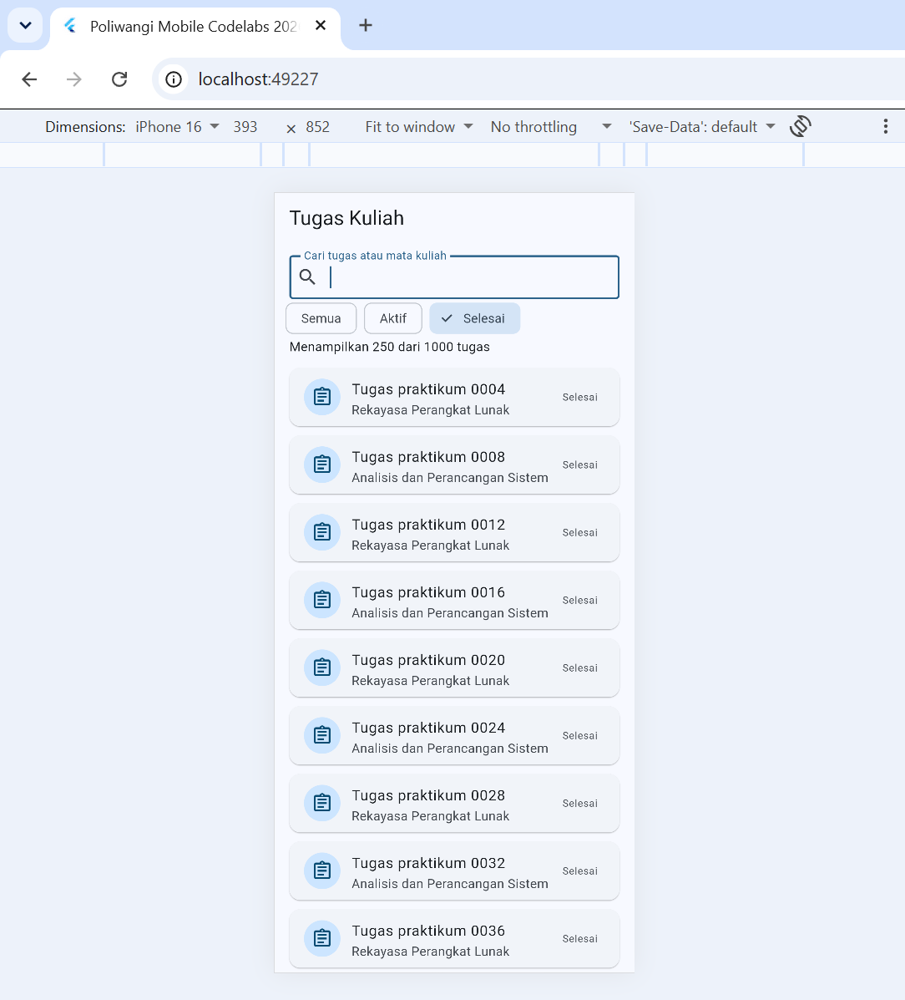

**c. Mengembalikan daftar penuh**

Setelah pengujian selesai, pencarian dibersihkan dan filter Semua dipilih kembali. Hasil yang ditampilkan seharusnya kembali menjadi 1.000 tugas.

#### 5. Mengukur Performa Menggunakan Profile Mode

Pada tahap ini dilakukan pengukuran performa aplikasi menggunakan Profile Mode pada perangkat [nama perangkat].

**Perintah yang digunakan:**

```bash
flutter run --profile
```

Setelah aplikasi dijalankan, Flutter DevTools dibuka dan Performance View digunakan untuk mengamati performa aplikasi ketika melakukan scrolling dan mengetikkan kata kunci pencarian.

**Hasil pengamatan:**

Pengukuran awal dilakukan menggunakan Chrome DevTools pada halaman aplikasi Modul 11 dengan simulasi ukuran layar iPhone 16 sebesar 393 × 852 piksel. Berdasarkan hasil pengamatan pada bagian Live Metrics, diperoleh nilai Cumulative Layout Shift (CLS) sebesar 0 dan Interaction to Next Paint (INP) sebesar 32 ms. Nilai CLS menunjukkan bahwa tidak ditemukan pergeseran tata letak yang tidak terduga selama pengukuran, sedangkan nilai INP menunjukkan bahwa interaksi pengguna mendapatkan respons visual dengan cepat. Sementara itu, Largest Contentful Paint (LCP) belum menampilkan nilai pengukuran pada saat screenshot diambil.

**Dokumentasi:**

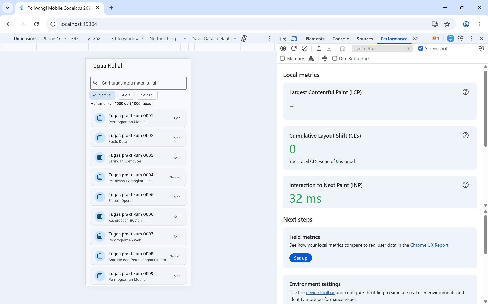

#### 6. Melakukan Optimasi dan Pengukuran Ulang

Pada tahap ini dilakukan perubahan kecil terhadap implementasi widget dengan menambahkan `const` pada widget anak yang memiliki nilai konstan.

**Perubahan kode:**

Sebelum optimasi:

```dart
title: Text('Tugas Kuliah'),
```

Sesudah optimasi:

```dart
title: const Text('Tugas Kuliah'),
```

Perubahan dilakukan tanpa mengubah fungsi utama aplikasi. Setelah perubahan diterapkan, dilakukan pemeriksaan kode dan pengujian ulang menggunakan perintah:

```bash
flutter analyze

flutter test test/modul_11_test.dart

flutter run --profile
```

**Hasil perbandingan:**

**Analisis:**

Berdasarkan pengukuran menggunakan Chrome DevTools, diperoleh nilai INP sebesar 32 ms pada pengukuran sebelumnya dan 40 ms pada pengukuran tanpa penambahan const. Terdapat peningkatan waktu respons sebesar 8 ms pada pengukuran tanpa const, yang menunjukkan respons interaksi sedikit lebih lambat dibandingkan pengukuran sebelumnya. Sementara itu, nilai CLS pada kedua pengukuran tetap sebesar 0, sehingga tidak ditemukan perubahan pada kestabilan tata letak aplikasi. Nilai LCP belum tersedia pada kedua pengukuran.

**Dokumentasi:**

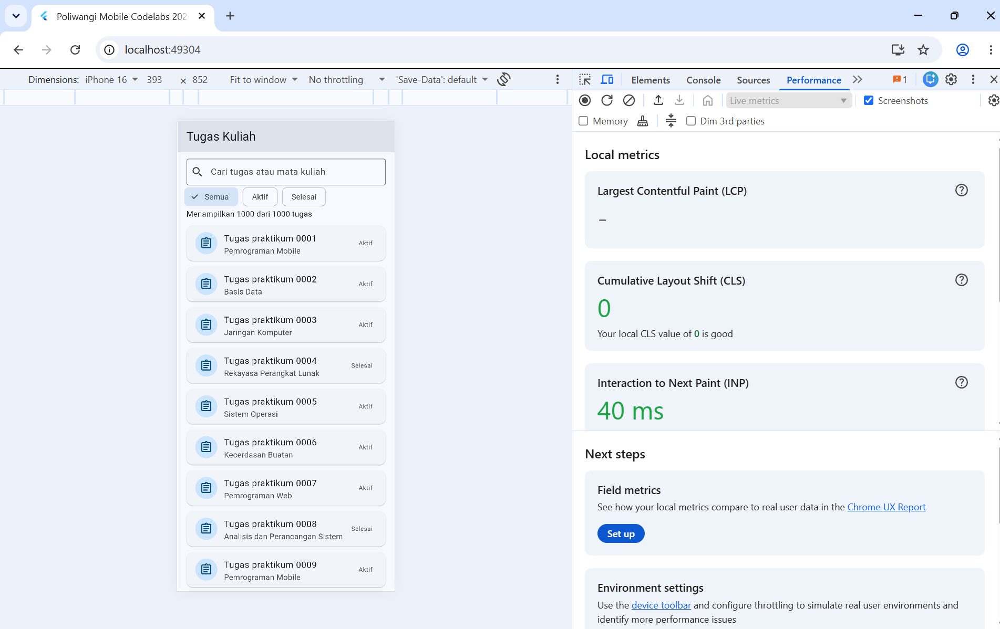

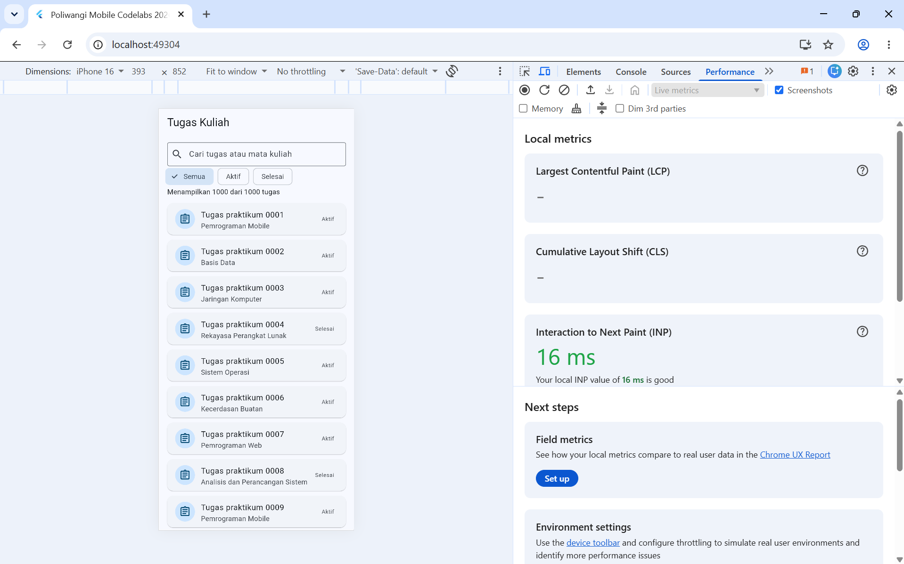

### D. Kesimpulan Praktikum

Berdasarkan praktikum yang telah dilakukan, dapat dipahami bahwa `ListView.builder` merupakan salah satu pendekatan untuk menampilkan daftar data dalam jumlah besar secara bertahap sesuai kebutuhan tampilan. Pengelolaan data menggunakan `List.generate`, enum, variabel pencarian, dan getter penyaringan memungkinkan aplikasi menampilkan daftar tugas sesuai dengan kriteria yang dipilih pengguna.

Melalui pengujian yang dilakukan, fitur pencarian dan filter dapat digunakan untuk memperoleh data yang sesuai dengan kata kunci maupun status tugas. Selain itu, pengujian menggunakan Profile Mode dan Flutter DevTools memberikan pemahaman mengenai proses pengamatan performa aplikasi, khususnya ketika melakukan scrolling dan pencarian. Perubahan implementasi menggunakan `const` juga memberikan pengalaman dalam menerapkan optimasi widget serta membandingkan hasil pengukuran sebelum dan sesudah perubahan.